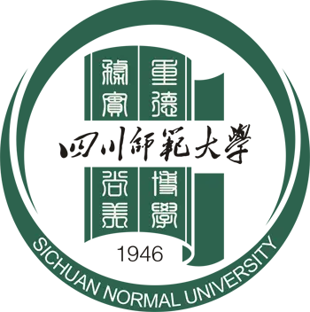

<!-- 图片 -->

  <a href="https://www.sicnuwiki.com">
    <!--  -->
    
    
  </a>

<middle>四川师范大学-飞跃手册</middle>

- SICNU wiki Since 2022.10 
&nbsp;&nbsp;&nbsp; 
- All Rights Reserved.

四川师范大学飞跃手册收录学习、保研、考研、就业与留学经验，帮助川师学子快速获取真实经验分享与路径参考。

站内内容以川师大学长学姐的一手经验为主，覆盖大学学习、升学就业、校园生活与知识分享等方向。

 

    👀 本站总访问量： 次

    | 🚴‍♂️ 本站总访客数： 人

 
 
<!-- 添加star, fork徽标 -->
<a href='https://github.com/SICNU-Application/wiki-SICNU/stargazers'></img></a>
<a href='https://github.com/SICNU-Application/wiki-SICNU/network/members'></img></a>
 

[Github](https://github.com/SICNU-Application/wiki-SICNU) [点击进入](./README)

<!-- [点击进入](./README.md) --> 
<!-- 添加背景图片 -->
<!--  -->

